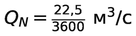
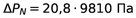
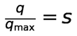
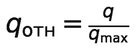

# Лабораторная работа № 2

## Определение расходной характеристики регулирующей арматуры при работе на реальную гидравлическую трассу

**Расчётное моделирование выполнено в системном теплогидравлическом коде КОРСАР.**

---

## 1. Цель работы

Целью работы является получение расходной характеристики регулирующей арматуры при её работе в гидравлической сети методом расчётного моделирования в системном теплогидравлическом коде КОРСАР.

В ходе выполнения работы необходимо приобрести навыки составления зоны задания расчётного варианта, работы с элементами `CH`, `VAL`, `BVOL_T`, `LR`, `CPUMP`, обработки результатов расчёта и оценки регулирующих характеристик арматуры при её работе в гидравлической сети.

## 2. Постановка задачи

В работе рассматривается течение теплоносителя через регулирующий клапан (РК), установленный на участке трубопровода DN50. Трубопровод представлен каналом, длина ячеек которого составляет 1 м; третья ячейка канала имеет DN100.

Последовательно с регулирующим клапаном установлено местное гидравлическое сопротивление, моделирующее потребителя. Движение теплоносителя обеспечивается насосом, характеристика которого задаётся в расчётной модели КОРСАР.

Расчётная схема включает следующие основные элементы:

- `BVOL_T` — граничные объёмы на входе и выходе расчётного канала;
- `CH` — гидравлический канал;
- `CPUMP` — центробежный насос;
- `VAL` — регулирующий клапан;
- `LR` — местное гидравлическое сопротивление.

## 3. Исходные данные

Основные параметры расчётной задачи приведены в таблице.

| Параметр | Значение |
|:---|:---:|
| Температура потока | 20 °C |
| Давление на всасе насоса | 1 МПа |
| Условный проход основного участка трубопровода | DN50 |
| Условный проход третьей ячейки канала | DN100 |
| Длина ячеек канала | 1 м |
| Пропускная способность клапана `Kvу` | 33 |
| Пропускная характеристика клапана | Линейная |
| Исходный коэффициент гидравлического сопротивления (КГС) | 140 |

В методических исходных данных задано базовое значение КГС = 140. При этом в файле `kordat` предусмотрен последовательный расчёт для пяти значений КГС: 28, 70, 140, 210 и 350; расчёт начинается со значения 28, а значение 140 является третьим этапом серии. Характеристика насоса задаётся в режиме `MODE = 2` — по перепаду давления насоса. В расчётном файле указаны номинальные параметры:

- Номинальный расход насоса:

  

- Номинальный перепад давления насоса:

  

В управляющем событии насоса задаются значения перепада и его производной по расходу. Таким образом, насос обеспечивает циркуляцию теплоносителя в расчётной гидравлической трассе.

## 4. Задачи работы

В соответствии с заданием необходимо:

1. Определить расходную характеристику регулирующего клапана в абсолютном и относительном виде `q = f(s)`, сравнить её с пропускной характеристикой.
2. Исследовать изменение расходной характеристики РК при изменении КГС местного сопротивления в диапазоне от −80 % до +150 % относительно заданного значения.

## 5. Методика проведения расчёта

Для получения расходной характеристики регулирующего клапана изменяется относительное положение его рабочего органа `s` в диапазоне от 0 до 1.

В расчётном файле реализовано автоматическое изменение положения клапана с шагом 0,01 через каждые 10 секунд расчётного времени. При каждом положении клапана регистрируются его относительное открытие, расход в канале и текущее значение КГС местного сопротивления.

Для исследования влияния сопротивления сети используются следующие значения КГС:

| КГС | Изменение относительно исходного значения 140 |
|:---:|:---:|
| 28 | −80 % |
| 70 | −50 % |
| 140 | 0 % |
| 210 | +50 % |
| 350 | +150 % |

При переходе к следующему значению КГС положение клапана возвращается к нулю, после чего выполняется новый цикл его открытия. Это позволяет получить семейство расходных характеристик для различных сопротивлений сети.

Для сравнения с реальной расходной характеристикой используется идеальная линейная пропускная характеристика. В относительных единицах она соответствует зависимости:

**Идеальная линейная пропускная характеристика:**

где `s` — относительное положение рабочего органа клапана, `q` — расход при данном положении клапана, `qₘₐₓ` — расход при полном открытии клапана для рассматриваемой характеристики.

Относительный расход определяется нормировкой:

**Относительный расход:**

## 6. Результаты расчёта

### 6.1. Сравнение пропускной и расходной характеристик РК

На рисунке 1 представлено сравнение идеальной линейной пропускной характеристики клапана и фактической расходной характеристики при работе в гидравлической сети с КГС = 140.

**Рисунок 1 — Сравнение пропускной и расходной характеристик регулирующего клапана при КГС = 140**

Из графика видно, что фактическая расходная характеристика отличается от идеальной линейной пропускной характеристики.

При одинаковом относительном положении клапана относительный расход в реальной гидравлической сети оказывается выше значения, соответствующего линейной зависимости. Например, при `s ≈ 0,2` относительный расход составляет около 0,52, тогда как идеальная линейная характеристика даёт значение 0,2. При `s ≈ 0,4` фактический относительный расход составляет около 0,80.

По мере открытия клапана кривая фактической расходной характеристики постепенно выходит на пологий участок и приближается к единице при полном открытии.

Таким образом, линейная пропускная характеристика самого клапана не обеспечивает линейного изменения расхода при его работе в реальной гидравлической сети. На итоговую зависимость влияет совместное действие клапана и сопротивления остальных элементов трассы.

### 6.2. Влияние КГС местного сопротивления на расходную характеристику РК

На рисунке 2 показано изменение расходной характеристики клапана при различных значениях коэффициента гидравлического сопротивления местного сопротивления.

**Рисунок 2 — Влияние сопротивления сети (КГС) на расходную характеристику регулирующего клапана**

На графике представлены пять расчётных характеристик, соответствующих значениям КГС = 28, 70, 140, 210 и 350.

Из графика следует, что увеличение КГС приводит к уменьшению расхода через систему при одном и том же положении регулирующего клапана. Наибольший расход достигается при КГС = 28, а наименьший — при КГС = 350.

При малых открытиях клапана различия между характеристиками выражены слабее. По мере увеличения открытия влияние сопротивления сети становится более заметным. При полном открытии клапана расход составляет приблизительно:

| КГС | Расход при `s ≈ 1`, кг/с |
|:---:|:---:|
| 28 | 28 |
| 70 | 18,8 |
| 140 | 13,5 |
| 210 | 11 |
| 350 | 8,5 |

Значения в таблице являются приблизительным считыванием с представленного графика.

Следовательно, расходная характеристика регулирующего клапана определяется не только его собственной пропускной способностью и степенью открытия, но и сопротивлением гидравлической сети, в которой он установлен.

## 7. Анализ результатов

По результатам расчётного моделирования можно сделать следующие наблюдения:

1. Идеальная пропускная характеристика клапана является линейной, однако фактическая расходная характеристика при работе в сети имеет нелинейный вид.
2. При КГС = 140 фактический относительный расход на начальном участке открытия клапана увеличивается быстрее, чем это следует из идеальной линейной характеристики.
3. Увеличение сопротивления местного элемента приводит к снижению расхода во всём диапазоне открытия клапана.
4. При уменьшении КГС пропускная способность всей гидравлической системы возрастает, поэтому при одинаковом положении клапана через него проходит больший расход.
5. Характеристика регулирующего клапана в составе реальной системы отличается от характеристики клапана, рассматриваемого отдельно от трубопроводной сети.

Полученные графики показывают, что при выборе и настройке регулирующей арматуры необходимо учитывать параметры всей гидравлической системы, а не только паспортную пропускную характеристику клапана.

## 8. Выводы

В ходе лабораторной работы была рассмотрена работа регулирующего клапана в составе реальной гидравлической трассы методом расчётного моделирования в коде КОРСАР.

Получена и рассмотрена расходная характеристика регулирующего клапана при исходном значении КГС = 140. Выполнено её сравнение с идеальной линейной пропускной характеристикой. Установлено, что фактическая зависимость расхода от положения клапана является нелинейной.

Также исследовано влияние изменения коэффициента гидравлического сопротивления местного сопротивления на расходную характеристику клапана. При увеличении КГС от 28 до 350 расход через систему уменьшается. Наибольший расход наблюдается при минимальном сопротивлении сети, а наименьший — при максимальном.

Таким образом, расходная характеристика регулирующего клапана существенно зависит от гидравлического сопротивления системы, в которой он работает. При оценке регулирующих свойств арматуры необходимо учитывать совместную характеристику клапана и сети.

## 9. Сокращения и обозначения

| Обозначение | Расшифровка |
|:---:|:---|
| DN | Условный проход |
| `Kv` | Пропускная способность клапана |
| `Q` | Объёмный расход |
| `s` | Относительное положение рабочего органа |
| КГС | Коэффициент гидравлического сопротивления |
| РК | Регулирующий клапан |
| РО | Регулирующий орган |
| `q` | Расход через клапан |
| `qₘₐₓ` | Максимальный расход, используемый для нормировки |

## 10. Список литературы

1. Благов Э. Е., Ивницкий Б. Я. Дроссельно-регулирующая арматура ТЭС и АЭС. — М.: Энергоатомиздат, 1990. — 288 с.
2. РТМ 108.711.02-79. Арматура энергетическая. Методы определения пропускной способности регулирующих органов и выбор оптимальной расходной характеристики.
3. КОРСАР/В3. Руководство пользователя. — https://korsar.niti.ru
