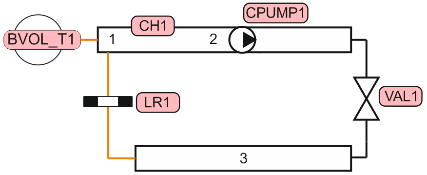
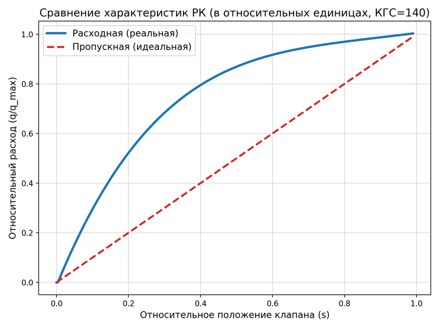
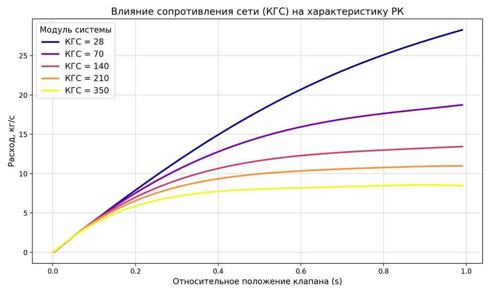

# Лабораторная работа № 2

## Определение расходной характеристики регулирующей арматуры при работе на реальную гидравлическую трассу

**Расчётное моделирование выполнено в системном теплогидравлическом коде КОРСАР.**

---

## 1. Цель работы

В ходе лабораторной работы мы должны были получить расходную характеристику регулирующего клапана, установленного в реальную гидравлическую трассу. Для этого мы использовали расчётное моделирование в программе КОРСАР и проследили, как меняется расход теплоносителя при изменении степени открытия клапана.

Также в процессе работы мы отработали составление расчётной схемы, настройку основных элементов модели (`CH`, `VAL`, `BVOL_T`, `LR`, `CPUMP`) и обработку полученных результатов. Это позволило оценить, насколько фактическая регулирующая характеристика клапана отличается от его идеальной пропускной характеристики.

## 2. Постановка задачи

Для выполнения работы мы рассмотрели участок гидравлической системы, в котором теплоноситель проходит через регулирующий клапан и местное гидравлическое сопротивление, моделирующее потребителя. Движение теплоносителя создаётся насосом, характеристика которого задаётся в расчётной модели КОРСАР.

Основной участок трубопровода имеет условный проход DN50. Канал разбит на расчётные ячейки длиной 1 м, при этом для третьей ячейки задан условный проход DN100. Регулирующий клапан и местное сопротивление включены в гидравлическую трассу последовательно.

При построении расчётной модели мы использовали следующие элементы:

- `BVOL_T` — граничный объём, задающий условия на границе расчётной схемы;
- `CH` — гидравлический канал, разделённый на расчётные ячейки;
- `CPUMP` — центробежный насос, обеспечивающий циркуляцию теплоносителя;
- `VAL` — регулирующий клапан, степень открытия которого изменяется в ходе расчёта;
- `LR` — местное гидравлическое сопротивление.

**Схема нодализации расчётного варианта** приведена на рисунке ниже. По ней видно, как перечисленные элементы соединены между собой в единую гидравлическую трассу.

На схеме обозначены граничный объём `BVOL_T1`, канал `CH1` с ячейками 1–3, насос `CPUMP1`, регулирующий клапан `VAL1` и местное сопротивление `LR1`.

## 3. Исходные данные

Перед проведением расчёта мы задали исходные параметры системы в соответствии с методическими указаниями. Основные значения, использованные в модели, приведены в таблице.

| Параметр | Значение |
|:---|:---:|
| Температура потока | 20 °C |
| Давление на всасе насоса | 1 МПа |
| Условный проход основного участка трубопровода | DN50 |
| Условный проход третьей ячейки канала | DN100 |
| Длина ячеек канала | 1 м |
| Пропускная способность клапана `Kvу` | 33 |
| Пропускная характеристика клапана | Линейная |
| Исходный коэффициент гидравлического сопротивления (КГС) | 140 |

В качестве базового значения коэффициента гидравлического сопротивления мы приняли КГС = 140, как указано в задании. Кроме этого, в расчётном файле `kordat` предусмотрено последовательное проведение расчётов для пяти значений КГС: 28, 70, 140, 210 и 350. Таким образом, можно сравнить работу клапана не только при исходном сопротивлении, но и при его уменьшении или увеличении.

Характеристика насоса задаётся в режиме `MODE = 2`, то есть через перепад давления на насосе. В расчётном файле указаны следующие номинальные параметры:

- Номинальный расход насоса: **Qₙ = 22,5 / 3600 = 0,00625 м³/с**.
- Номинальный перепад давления насоса: **ΔPₙ = 20,8 × 9810 = 204 048 Па**.

Эти значения используются при задании характеристики насоса в модели. В управляющем событии также задаются перепад давления и его производная по расходу, благодаря чему насос обеспечивает циркуляцию теплоносителя по рассматриваемой трассе.

## 4. Задачи работы

В соответствии с заданием необходимо:

1. Определить расходную характеристику регулирующего клапана в абсолютном и относительном виде `q = f(s)`, сравнить её с пропускной характеристикой.
2. Исследовать изменение расходной характеристики РК при изменении КГС местного сопротивления в диапазоне от −80 % до +150 % относительно заданного значения.

## 5. Методика проведения расчёта

Сначала мы настроили расчёт так, чтобы можно было проследить, как меняется расход при постепенном открытии регулирующего клапана. Для этого относительное положение его рабочего органа `s` изменялось от 0 (клапан закрыт) до 1 (клапан полностью открыт).

Изменение положения клапана выполнялось автоматически: шаг составлял 0,01, а новое значение задавалось через каждые 10 секунд расчётного времени. Таким образом, на каждом этапе клапан немного открывался, после чего программа рассчитывала параметры потока. Мы фиксировали положение клапана, расход в канале и текущее значение коэффициента гидравлического сопротивления (КГС).

Затем мы проверили, как на полученную характеристику влияет сопротивление сети. Для этого расчёт повторялся при пяти значениях КГС. За исходное значение было принято 140, а остальные значения соответствовали изменению сопротивления относительно него:

| КГС | Изменение относительно исходного значения 140 |
|:---:|:---:|
| 28 | −80 % |
| 70 | −50 % |
| 140 | 0 % |
| 210 | +50 % |
| 350 | +150 % |

Перед каждым новым циклом изменения КГС положение клапана снова устанавливалось равным нулю. После этого запускался очередной цикл его открытия от 0 до 1. Такой порядок позволил получить и сравнить несколько расходных характеристик, не меняя остальные условия расчёта.

В завершение мы сопоставили полученные зависимости с идеальной линейной пропускной характеристикой клапана. Для идеального случая относительный расход должен изменяться пропорционально степени открытия:

**qₒₜₙ = s**

Здесь `s` — относительное положение рабочего органа клапана, а `qₒₜₙ` — относительный расход. Чтобы перейти от абсолютного расхода к относительному, расход при каждом положении клапана делится на расход при полном открытии:

**qₒₜₙ = q / qₘₐₓ**

где `q` — расход при текущем положении клапана, а `qₘₐₓ` — расход при его полном открытии для соответствующей расчётной характеристики. После нормировки характеристики можно сравнивать на одном графике, даже если абсолютные расходы при разных значениях КГС отличаются.

## 6. Результаты расчёта

### 6.1. Сравнение пропускной и расходной характеристик РК

На рисунке 1 представлено сравнение идеальной линейной пропускной характеристики клапана и фактической расходной характеристики при работе в гидравлической сети с КГС = 140.

**Рисунок 1 — Сравнение пропускной и расходной характеристик регулирующего клапана при КГС = 140**

Из графика видно, что фактическая расходная характеристика отличается от идеальной линейной пропускной характеристики.

При одинаковом относительном положении клапана относительный расход в реальной гидравлической сети оказывается выше значения, соответствующего линейной зависимости. Например, при `s ≈ 0,2` относительный расход составляет около 0,52, тогда как идеальная линейная характеристика даёт значение 0,2. При `s ≈ 0,4` фактический относительный расход составляет около 0,80.

По мере открытия клапана кривая фактической расходной характеристики постепенно выходит на пологий участок и приближается к единице при полном открытии.

Таким образом, линейная пропускная характеристика самого клапана не обеспечивает линейного изменения расхода при его работе в реальной гидравлической сети. На итоговую зависимость влияет совместное действие клапана и сопротивления остальных элементов трассы.

### 6.2. Влияние КГС местного сопротивления на расходную характеристику РК

На рисунке 2 показано изменение расходной характеристики клапана при различных значениях коэффициента гидравлического сопротивления местного сопротивления.

**Рисунок 2 — Влияние сопротивления сети (КГС) на расходную характеристику регулирующего клапана**

На графике представлены пять расчётных характеристик, соответствующих значениям КГС = 28, 70, 140, 210 и 350.

Из графика следует, что увеличение КГС приводит к уменьшению расхода через систему при одном и том же положении регулирующего клапана. Наибольший расход достигается при КГС = 28, а наименьший — при КГС = 350.

При малых открытиях клапана различия между характеристиками выражены слабее. По мере увеличения открытия влияние сопротивления сети становится более заметным. При полном открытии клапана расход составляет приблизительно:

| КГС | Расход при `s ≈ 1`, кг/с |
|:---:|:---:|
| 28 | 28 |
| 70 | 18,8 |
| 140 | 13,5 |
| 210 | 11 |
| 350 | 8,5 |

Значения в таблице являются приблизительным считыванием с представленного графика.

**Сравнение с независимым ручным расчётом.** Дополнительно выполнена оценка расхода через полностью открытый клапан по его пропускной способности `Kv = 33`. Принимая давления `P3 = 11,8 бар` и `P2 = 9,9 бар`, получаем перепад `ΔP = P3 − P2 = 1,9 бар`. При плотности воды `ρ = 1000 кг/м³` расход определён по формуле:

**Формула расчёта:**

`Q = Kv × √(ΔP × 1000 / ρ)`

**Подстановка значений:**

`Q = 33 × √(1,9 × 1000 / 1000) = 45,4874 м³/ч`,

где `ΔP = 1,9 бар`, `ρ = 1000 кг/м³`, а расход `Q` получается в `м³/ч`.

Для сопоставления расход из графика при `КГС = 140` и полном открытии клапана (`s = 1`) составляет приблизительно `13,5 кг/с`, что при `ρ = 1000 кг/м³` соответствует `48,6 м³/ч`. Разница между ручной оценкой и значением, считанным с графика, составляет около `3,11 м³/ч`, или `6,4 %` относительно значения по графику. Таким образом, независимый расчёт по `Kv` даёт близкий результат и подтверждает порядок величины расхода, полученного при моделировании. Небольшое расхождение объясняется приближённым считыванием значения с графика и тем, что ручная оценка использует перепад давления непосредственно на клапане.

Следовательно, расходная характеристика регулирующего клапана определяется не только его собственной пропускной способностью и степенью открытия, но и сопротивлением гидравлической сети, в которой он установлен.

## 7. Анализ результатов

По результатам расчётного моделирования можно сделать следующие наблюдения:

1. Идеальная пропускная характеристика клапана является линейной, однако фактическая расходная характеристика при работе в сети имеет нелинейный вид.
2. При КГС = 140 фактический относительный расход на начальном участке открытия клапана увеличивается быстрее, чем это следует из идеальной линейной характеристики.
3. Увеличение сопротивления местного элемента приводит к снижению расхода во всём диапазоне открытия клапана.
4. При уменьшении КГС пропускная способность всей гидравлической системы возрастает, поэтому при одинаковом положении клапана через него проходит больший расход.
5. Характеристика регулирующего клапана в составе реальной системы отличается от характеристики клапана, рассматриваемого отдельно от трубопроводной сети.

Полученные графики показывают, что при выборе и настройке регулирующей арматуры необходимо учитывать параметры всей гидравлической системы, а не только паспортную пропускную характеристику клапана.

## 8. Выводы

В ходе лабораторной работы была рассмотрена работа регулирующего клапана в составе реальной гидравлической трассы методом расчётного моделирования в коде КОРСАР.

Получена и рассмотрена расходная характеристика регулирующего клапана при исходном значении КГС = 140. Выполнено её сравнение с идеальной линейной пропускной характеристикой. Установлено, что фактическая зависимость расхода от положения клапана является нелинейной.

Также исследовано влияние изменения коэффициента гидравлического сопротивления местного сопротивления на расходную характеристику клапана. При увеличении КГС от 28 до 350 расход через систему уменьшается. Наибольший расход наблюдается при минимальном сопротивлении сети, а наименьший — при максимальном.

Таким образом, расходная характеристика регулирующего клапана существенно зависит от гидравлического сопротивления системы, в которой он работает. При оценке регулирующих свойств арматуры необходимо учитывать совместную характеристику клапана и сети.

## 9. Сокращения и обозначения

| Обозначение | Расшифровка |
|:---:|:---|
| DN | Условный проход |
| `Kv` | Пропускная способность клапана |
| `Q` | Объёмный расход |
| `s` | Относительное положение рабочего органа |
| КГС | Коэффициент гидравлического сопротивления |
| РК | Регулирующий клапан |
| РО | Регулирующий орган |
| `q` | Расход через клапан |
| `qₘₐₓ` | Максимальный расход, используемый для нормировки |

## 10. Список литературы

1. Благов Э. Е., Ивницкий Б. Я. Дроссельно-регулирующая арматура ТЭС и АЭС. — М.: Энергоатомиздат, 1990. — 288 с.
2. РТМ 108.711.02-79. Арматура энергетическая. Методы определения пропускной способности регулирующих органов и выбор оптимальной расходной характеристики.
3. КОРСАР/В3. Руководство пользователя. — https://korsar.niti.ru
