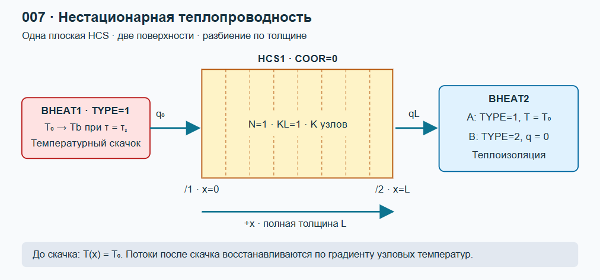
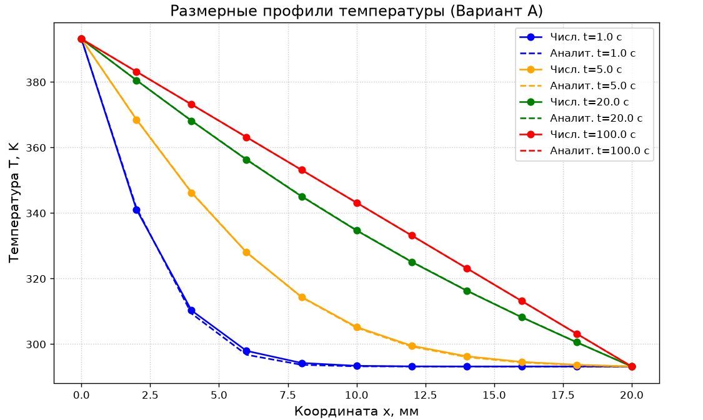
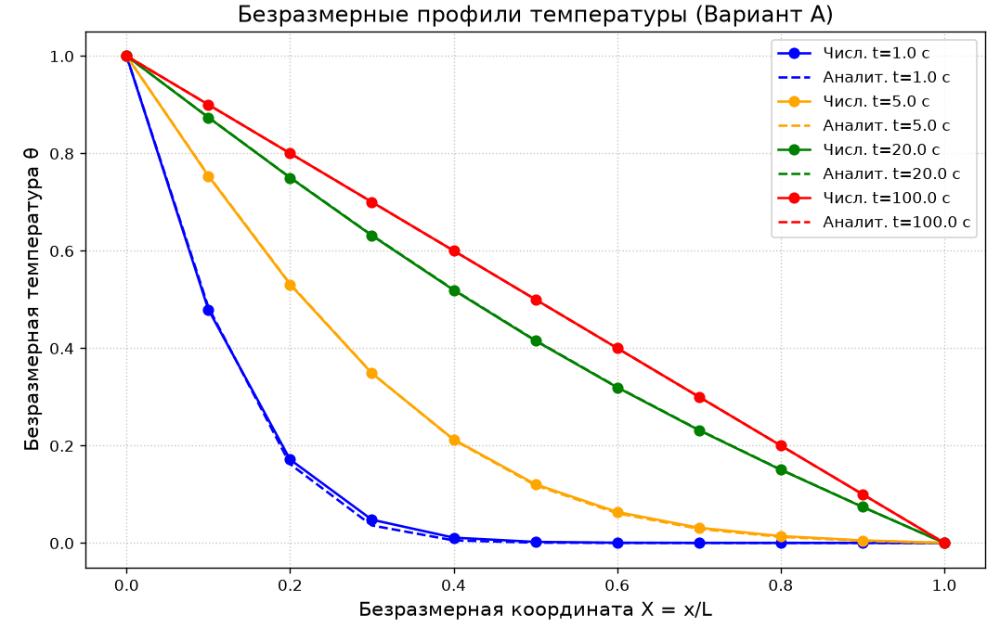
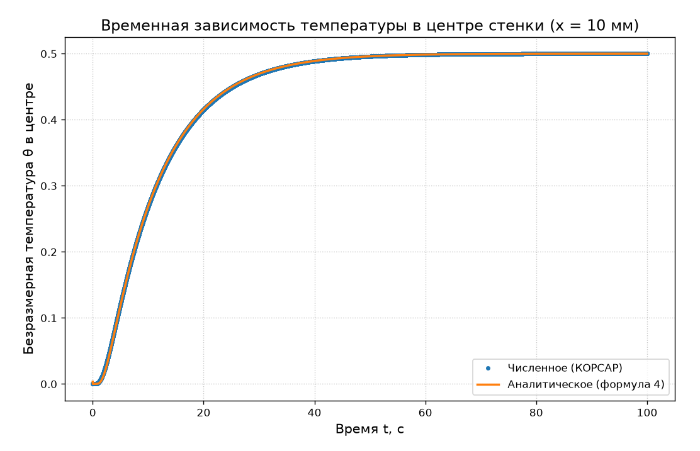
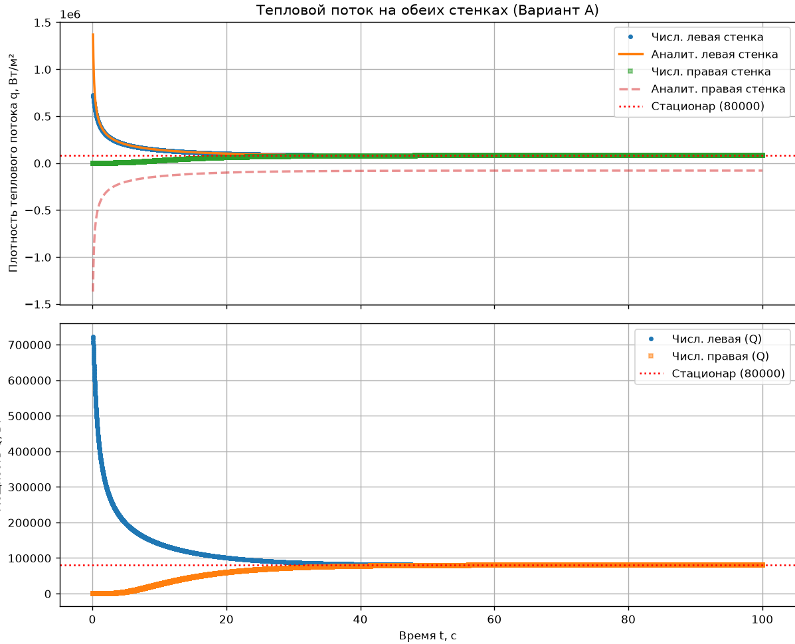
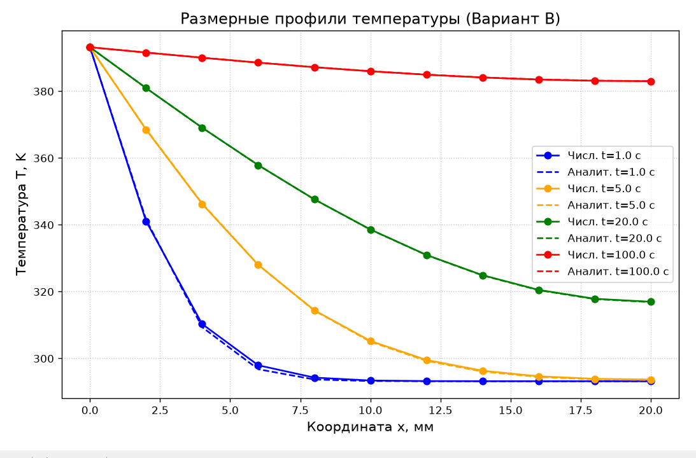
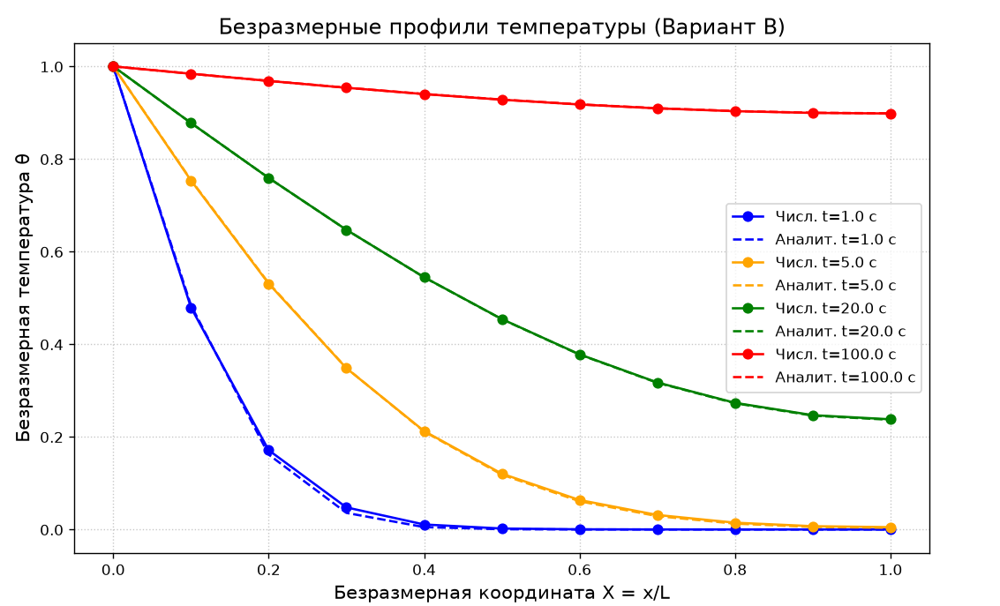
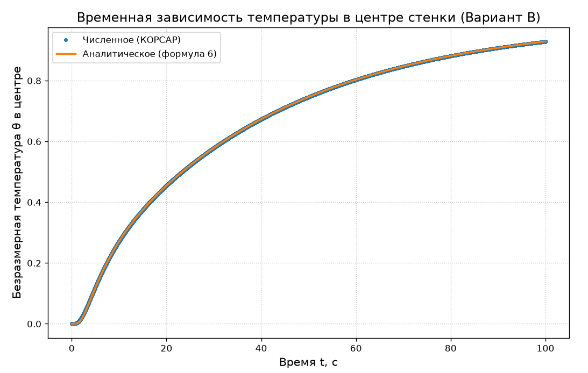
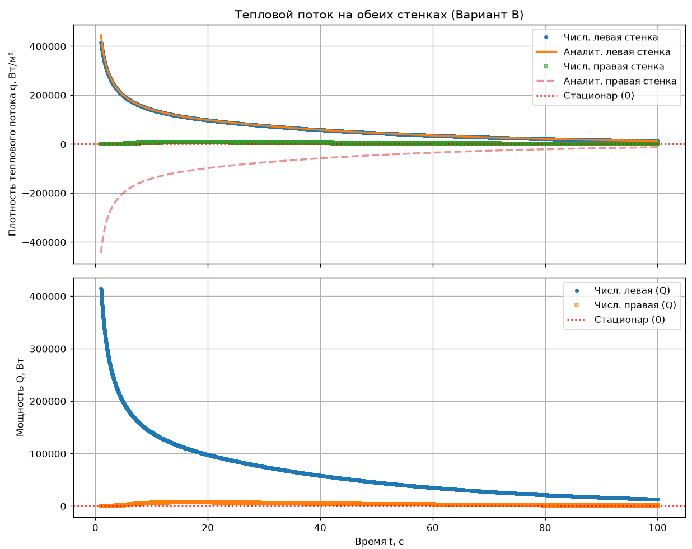

# Лабораторная работа № 1 . Нестационарная теплопроводность в плоской стенке

## 1. Цель работы
Собрать в РК КОРСАР расчетную схему из HCS и BHEAT для исследования прогрева однородной плоской стенки после скачка температуры на одной из поверхностей. Получить температурные профили, сравнить их с аналитическим решением и исследовать влияние разбиения по толщине.

**Выполнили:**  Вязов Илья, Каразанов Иван, Саламов Николай
**Группа:** М25-ВТГР-ПИШ
**Дата:** 30.10.26

## 2. Описание постановки задачи
В задаче моделируется прогрев однородной плоской стенки (сталь) толщиной \( L = 0.020 \) м. На левой границе задается скачок температуры до T_b = 393.15 К (120 °C). В **Варианте А** на правой границе поддерживается постоянная температура \( T_0 = 293.15 \) К (20 °C). В **Варианте В** правая граница теплоизолирована (\( q = 0 \)).

Параметры задачи:
*   Толщина стенки: 0.020 м
*   Теплопроводность: 16 Вт/(м·К)
*   Плотность: 7800 кг/м³
*   Теплоемкость: 500 Дж/(кг·К)
*   Начальная температура: 293.15 К

## 3. Требуемые результаты
*   Вывести графики распределения температуры (профили) в различные моменты времени.
*   Сравнить численное решение с аналитическим.
*   Определить значение установившегося теплового потока и сравнить с теоретическим (80 000 Вт/м² для Варианта А, 0 Вт/м² для Варианта В).

## 4. Ход выполнения работы

Для выполнения задачи были созданы файлы `kordat` и `kutdat`. Нодализационная схема задачи представлена на рисунке.

 
*Рисунок 1 — Нодализационная схема.*

В качестве начальных условий принималось равномерное распределение температуры \( T_0 = 293.15 \) К. В момент \( t = 0 \) задавался скачок температуры на левой границе. Вывод расчетных значений осуществлялся с периодичностью \( \Delta t = 0.01 \) с.

## 5. Получение результатов работы

Для получения результатов необходимо выполнить следующие шаги:
1. Выполнить запуск кода КОРСАР.
2. Выполнить процессинг бинарного файла `korres`.
3. Выполнить обработку результатов при помощи скрипта `plot.py`.

**Результаты расчета Варианта А:**

*Рисунок 2 — Размерные профили температуры \(T(x)\) для Варианта А.*

*Рисунок 3 — Безразмерные профили температуры \(\theta(X)\) для Варианта А.*

*Рисунок 4 — Временная зависимость температуры в центре стенки для Варианта А.*

*Рисунок 5 — Тепловой поток и мощность на границе источника тепла (выход на стационар 80 000 Вт/м²).*

**Результаты расчета Варианта В (адиабата):**

*Рисунок 6 — Размерные профили температуры для Варианта В.*

*Рисунок 7 — Безразмерные профили температуры для Варианта В.*

*Рисунок 8 — Временная зависимость температуры в центре стенки для Варианта В.*

*Рисунок 9 — Тепловой поток для Варианта В (стремится к нулю).*

## 6. Валидация результатов расчета

Для проверки результатов расчета использовалось аналитическое решение (формулы 4 и 6) и закон Фурье для стационарного режима.

Согласно расчетным оценкам, стационарный тепловой поток для Варианта А должен быть равен:
\[
 q = \lambda \frac{T_b - T_0}{L} = 16 \cdot \frac{100}{0.02} = 80\,000 \text{ Вт/м}^2 
\]

Для Варианта В стационарный поток равен 0 Вт/м², так как стенка полностью прогревается.

**Таблица 1 — Сравнение численного и аналитического решений (Вариант А, k=11):**

| Время, с | Макс. абсолютная погрешность, К | Относительная погрешность, % |
| :--- | :--- | :--- |
| 1.0 | 1.1826 | 1.1826 |
| 5.0 | 0.2625 | 0.2625 |
| 20.0 | 0.0797 | 0.0797 |
| 100.0 | 0.0006 | 0.0006 |

**Таблица 2 — Сравнение численного и аналитического решений (Вариант В, k=11):**

| Время, с | Макс. абсолютная погрешность, К | Относительная погрешность, % |
| :--- | :--- | :--- |
| 1.0 | 1.1826 | 1.1826 |
| 5.0 | 0.2671 | 0.2671 |
| 20.0 | 0.1039 | 0.1039 |
| 100.0 | 0.0352 | 0.0352 |

**Таблица 3 — Исследование сеточной сходимости (t=20 с, x=10 мм, Вариант А):**

| Число слоев (kl) | Число узлов (k) | Температура в центре, К | Отличие от аналитики, % |
| :--- | :--- | :--- | :--- |
| 2 | 3 | 333.45 | 1.29 |
| 4 | 5 | 334.31 | 0.43 |
| 10 | 11 | 334.66 | 0.08 |

**Таблица 4 — Исследование сеточной сходимости (t=20 с, x=10 мм, Вариант В):**

| Число слоев (kl) | Число узлов (k) | Температура в центре, К | Отличие от аналитики, % |
| :--- | :--- | :--- | :--- |
| 2 | 3 | 339.47 | 0.91 |
| 4 | 5 | 338.76 | 0.20 |
| 10 | 11 | 338.58 | 0.03 |

**Вывод:** Численная модель КОРСАР корректно описывает процесс нестационарной теплопроводности для обоих вариантов. Максимальная относительная погрешность не превышает 1.3% на начальном этапе (t=1 с) и снижается до 0.03% при выходе на стационарный режим. При увеличении количества узлов (измельчении сетки) численное решение сходится к аналитическому. Для дальнейших расчетов достаточно использовать \( kl=10 \) и \( k=11 \).

## 7. Список литературы
1. Руководство пользователя РК КОРСАР/В3. — Сосновый Бор, 2019.
2. Задание к лабораторной работе.
